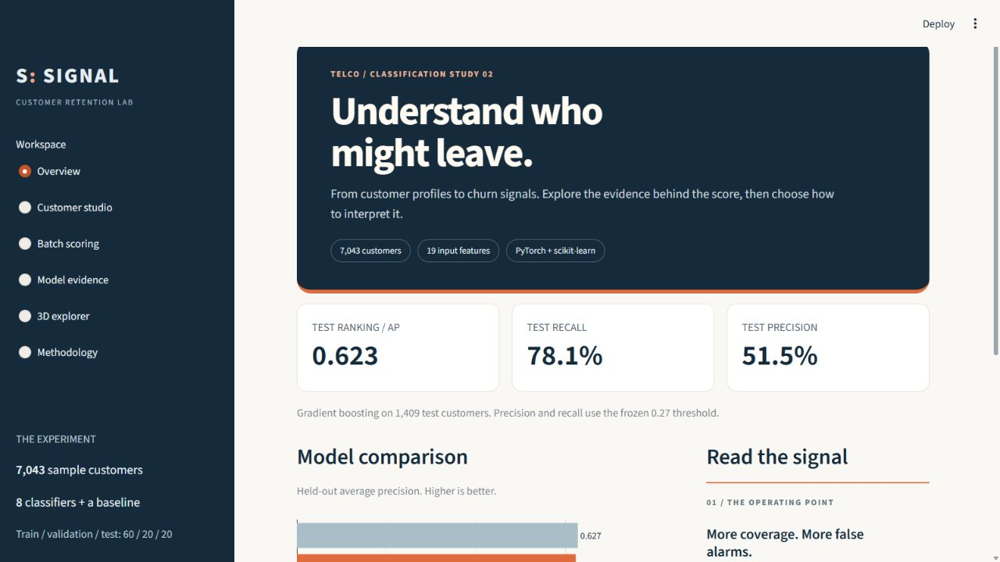
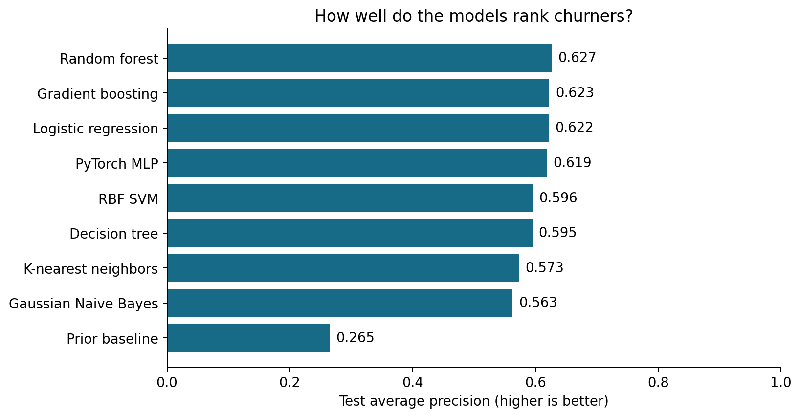
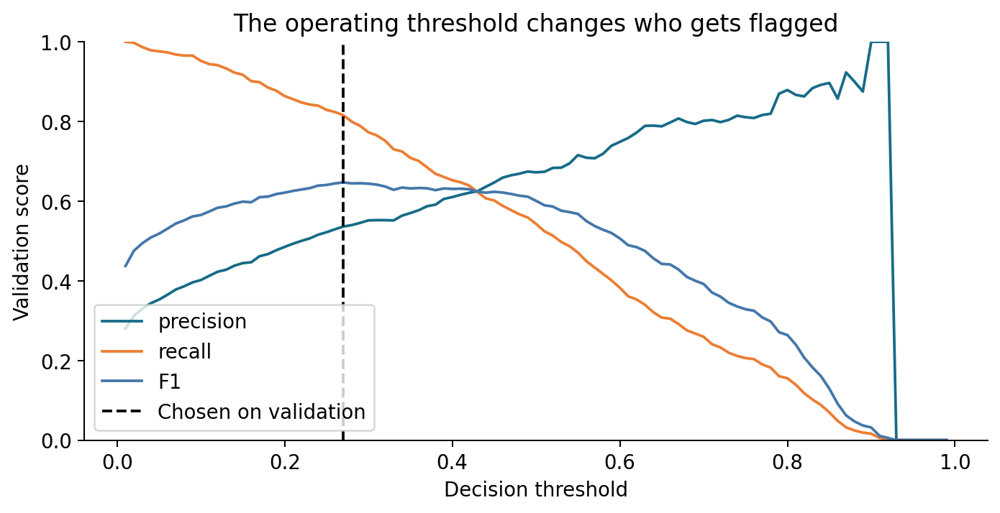
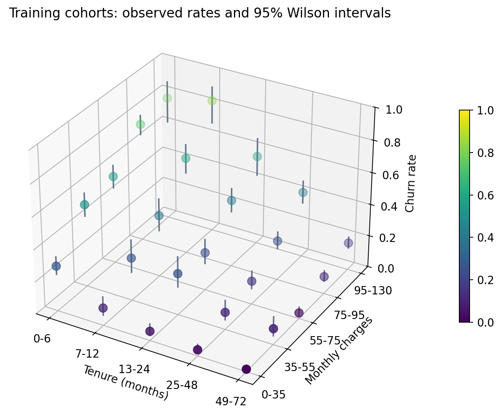
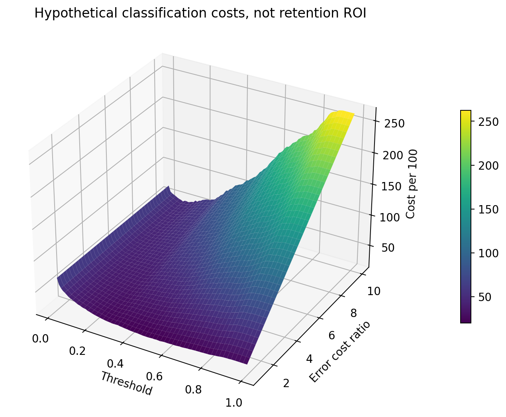
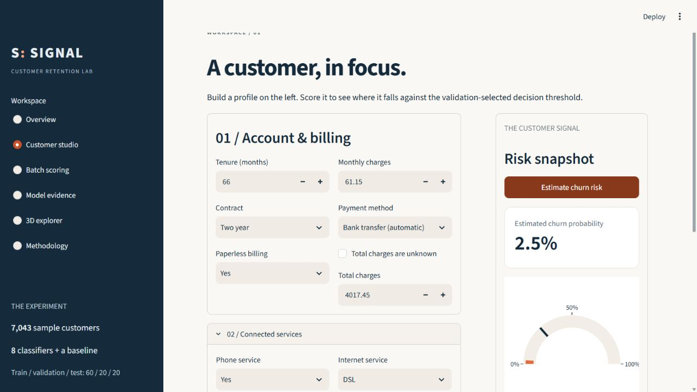
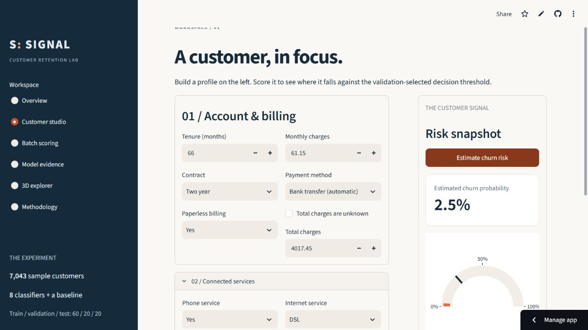

# Telco Customer Churn

A notebook-first classification case study with eight algorithms including a
PyTorch neural network, and a Streamlit app. The question is
how well customer profiles rank churn risk and how the decision threshold
changes false alarms and missed churners.

[Open Signal on Streamlit Community Cloud](https://swarneil-telco-churn.streamlit.app/)

## Start here

1. Open [the executed notebook](Telco_Customer_Churn.ipynb).
2. Read [the measured findings](reports/findings.md).
3. Open `reports/notebook.html` for a browser-readable notebook.
4. Run the Streamlit app to score a profile and explore the evidence.

## Run locally

Python 3.11 is recommended for a new environment. The local experiment
also runs on Python 3.10. CPU PyTorch keeps installation and hosting simple.

```powershell
cd "path\to\Telco Customer Churn"
python -m venv .venv
.\.venv\Scripts\python.exe -m pip install -r requirements-notebook.txt
.\.venv\Scripts\python.exe run_notebook.py
.\.venv\Scripts\python.exe verify_project.py
.\.venv\Scripts\python.exe -m streamlit run app.py --server.port 8502
```

In VS Code or Jupyter, select the project's `.venv` Python interpreter,
open `Telco_Customer_Churn.ipynb`, and run all cells from the project folder.
The notebook creates the fitted model, measured results, PNG figures,
and interactive HTML plots. `run_notebook.py` also exports the notebook
as HTML. The original CSV is never modified.

To use the existing trained app, only `requirements.txt` is necessary.
`requirements-notebook.txt` adds Jupyter and Matplotlib for reproduction.
Models are loaded only from this project's trusted local artifacts.

## Measured result

Validation selected **Gradient boosting** with decision threshold
**0.27**. On 1,409 untouched test customers:

| Metric | Result |
|---|---:|
| Average precision | 0.623 |
| ROC AUC | 0.827 |
| Recall at frozen threshold | 78.1% |
| Precision at frozen threshold | 51.5% |
| F1 at frozen threshold | 0.621 |

The threshold increases test F1 from 0.551 to 0.621. Gradient boosting's
AP advantage over logistic regression is inconclusive: the paired 95%
interval crosses zero. Random forest has the highest test AP, but the
validation-selected model stays fixed to avoid choosing on test results.



## Experimental design

- 7,043 customers; 26.5% churn. See [dataset provenance](DATASET.md).
- Stratified 60/20/20 train/validation/test split with seed 42.
- Customer IDs are excluded and cannot cross partitions.
- Imputation, scaling, and one-hot encoding fit inside training pipelines.
- Three-fold cross-validation uses training data only.
- Fixed candidate hyperparameters; validation average precision selects
  the model. Average precision is not trapezoidal PR area.
- Validation F1 selects a threshold on a fixed 0.01–0.99 grid.
- The selected training fit and threshold remain fixed for test evaluation.
- Paired customer bootstrap intervals evaluate two predeclared comparisons.

The file has no prediction timestamp or future outcome window. This is
retrospective classification, not a validated next-month forecasting system.

## Algorithms

| Algorithm | What this project demonstrates |
|---|---|
| Prior baseline | Why accuracy is inadequate for minority-class ranking |
| Logistic regression | Linear log-odds, regularization, encoded features |
| Decision tree | Nonlinear splits and controlled tree depth |
| Random forest | Bagging, feature subsampling, ensemble predictions |
| Gradient boosting | Sequential residual correction with shallow trees |
| Gaussian Naive Bayes | Independence and distribution assumptions |
| K-nearest neighbors | Scaled feature distances and local voting |
| RBF SVM | Kernel margins and training-only probability calibration |
| PyTorch MLP | ReLU layers, dropout, Adam, BCE loss, early stopping |

The MLP selects its epoch count on a separate internal stopping split,
then refits on all training rows. The stopping split has its own fitted
preprocessing. Network widths are 32 and 16. CUDA is unnecessary for this
small tabular dataset; the runnable neural-network code uses CPU PyTorch.

## Evidence and 3D plots







The cohort plot uses training data, at least 20 customers per displayed
cohort, and 95% Wilson intervals. It avoids inventing inconsistent billing
histories by showing observed grouped rates. Associations are not causal.
Open [the interactive cohort plot](reports/cohort_3d.html) locally.



The cost surface computes `100 * (FP + ratio * FN) / validation_customers`.
One false alarm costs one hypothetical unit. The missed-churn cost ratio
varies from 1 to 10. This is a classification decision exercise, not
measured retention ROI or evidence that an offer prevents churn.
Open [the interactive cost plot](reports/cost_3d.html) locally.

The app keeps all Plotly 3D backgrounds light with explicit axis colors.
It also includes confusion matrices, ranking curves, calibration,
permutation importance, subgroup checks, and neural learning curves.

## App workflow

The app is styled as **Signal**, a retention dashboard with sidebar
navigation and a navy, warm-white, and orange palette.

- **Overview:** model comparison and the main measured takeaways.
- **Customer studio:** grouped profile editor beside a risk gauge.
- **Batch scoring:** CSV input and prediction downloads.
- **Model evidence:** test results and validation threshold exploration.
- **3D explorer:** switch between cohort and decision-cost scenes.
- **Methodology:** inspect each algorithm and the evaluation sequence.



A changed profile clears the displayed score until it is scored again.

Enter a customer profile, estimate risk, and compare it with the frozen
validation threshold. Phone and internet options enforce their service
categories. Numeric bounds follow the training data; these checks do not
establish that every combination is a realistic customer.

For batches, download the input template, supply the 19 feature columns,
and upload up to 5,000 rows. Optional customer IDs are carried into output;
`Churn` is ignored. Missing total charges are supported. Unknown categories,
invalid numbers, and inconsistent service flags are rejected. The app
processes uploads in memory and does not save them to disk.

The validation threshold explorer does not modify the deployed decision
rule. Test metrics remain measurements of the previously frozen choices.

## Streamlit Community Cloud deployment

The live app runs from this public repository with these settings:

- Branch: `main`
- Entry point: `app.py`
- Python: 3.11
- Dependencies: root `requirements.txt`
- Required artifacts: `models/churn_model.joblib` and `reports/`

No database, API keys, or custom backend is needed. The app loads its fitted
pipeline on startup; it does not retrain. The reproducible all-model bundle
is ignored by Git to keep deployment smaller.

## Limits and follow-up work

A random holdout cannot measure time drift or generalization to another
operator. Probabilities are not personal certainties. Bootstrap intervals
condition on one fitted experiment and omit training and population shift
uncertainty. Subgroup results are descriptive, not fairness certification.

Future work needs dated snapshots, a defined forecast window, an out-of-time
evaluation, and treatment outcomes for retention impact. Any tuning after
reviewing this test set needs a fresh final evaluation set.

## References

- [IBM Telco example](https://github.com/IBM/telco-customer-churn-on-icp4d)
- [Scikit-learn decision thresholds](https://scikit-learn.org/stable/modules/classification_threshold.html)
- [Scikit-learn average precision](https://scikit-learn.org/stable/modules/generated/sklearn.metrics.average_precision_score.html)

## Hosted prediction check

The default customer returns 2.5% churn probability on the hosted app,
matching the local fitted model.


